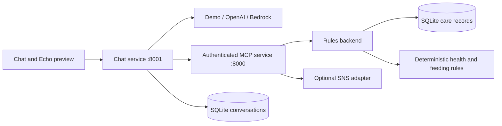

# Architecture

The server resolves household identity from configured credentials. The agent executes tools through MCP; views format structured results. The browser receives no model key or MCP token.

The chat UI loads read-only Today and veterinary cards into the left-hand Echo-style screen. The frame bridge validates the source window and initialization handshake. A new conversation or cat selection clears the displayed card.

This is a local prototype with a simulated display. Live Alexa integration, cloud deployment, production authentication, and public visitor isolation have not been completed. SQLite supports one deployed instance with persistent disk; no DynamoDB adapter is included.
