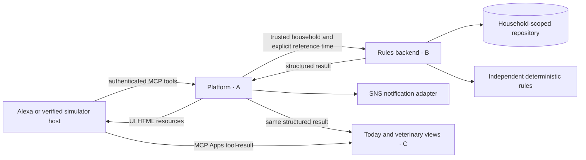

# Architecture and ownership

The server resolves household identity from trusted credentials; frontend pages contain no credentials and make no backend writes. The rules backend owns selection, windows, statistics, evidence and recommended wording. Views only format returned values. Veterinary results use timeline; today results use events. Notification states come from the service and preserve the distinction between provider acceptance and recipient delivery.

apps/resources.py builds self-contained HTML, CSS and JavaScript for ui://cat-nanny/today.html and ui://cat-nanny/vet-summary.html. No CDN, external image, browser persistence or telemetry is required. The bridge initializes with the parent host, accepts structuredContent only after initialization, and handles cancellation. Official lifecycle reference: https://apps.extensions.modelcontextprotocol.io/api/documents/overview.html . Host support and Alexa rendering require actual validation.

Current runtime and deployment choices are described by A in deployment.md, and data/rule details by B in rules.md. A local SQLite implementation or simulator must not be represented as a verified AWS/Alexa deployment.
